# 💪 Daily Challenges

The two daily challenges that closed the week.

## Contents

- [`Modules/`](Modules/): times full page downloads with `requests` and `time`, has a small CLI and tests
- [`OOPQuiz/`](OOPQuiz/): short answers to the OOP quiz, and `Card` and `Deck` classes

---

## 👤 Author

**Kevin Cusnir 'Lirioth'**  
Repository: [Fullstack2026](https://github.com/LiriothTeltanion/Fullstack2026)  
Week 2 Day 5 - Mini-projects - Daily Challenges
