# Mini‑project — Anagram checker 🧠🔤

<div align="center">




</div>

Files (lowercase, no underscores):
- `anagramchecker.py` — class **AnagramChecker** (loads word list, validates words, finds anagrams). No printing.
- `anagrams.py` — UI/CLI that handles input validation and pretty output.
- `words.txt` — small built‑in word list for offline use (you can replace it with a larger list).

## Run
```bash
python anagrams.py              # uses words.txt in the same folder
python anagrams.py /path/words.txt   # use a custom word list
```

## Class API (no prints)
```python
from anagramchecker import AnagramChecker
ac = AnagramChecker("words.txt")
ac.is_valid_word("meat")     # -> True/False
ac.get_anagrams("meat")      # -> ["MATE", "TAME", "TEAM"] (order deterministic)
ac.is_anagram("listen", "silent")  # -> True
```

## Notes
- Words are normalized to **UPPERCASE** internally; UI displays uppercase and anagrams in lowercase for readability.
- The code uses emoji‑rich comments and clean OOP separation, as requested. ✨
