# 📚 Exercises

The three Day 5 mini projects.

## Contents

- [`AnagramChecker/`](AnagramChecker/) — checks a word against a word list and shows its anagrams
- [`RockPaperScissors/`](RockPaperScissors/) — rock, paper, scissors against the computer with a score summary
- [`WeatherApp/`](WeatherApp/) — weather, forecasts and air quality from OpenWeatherMap, plus a humidity chart

---

## 👤 Author

**Kevin Cusnir 'Lirioth'**  
Repository: [Fullstack2026](https://github.com/LiriothTeltanion/Fullstack2026)  
Week 2 Day 5 - Mini-projects - Exercises
