# Mini Project — Rock Paper Scissors 🎮🪨📄✂️

<div align="center">




</div>

Lowercase filenames, no underscores, and emoji-rich comments.  
Two modules:
- `game.py` — core game logic (`Game` class: user/computer item, result, play).
- `rockpaperscissors.py` — UI/menu, score tracking, and summary.

## Run
```bash
python rockpaperscissors.py
```
Menu options:
- **Play a new game** — runs one round and records the result
- **Show scores** — prints current totals
- **Quit** — prints a final summary and exits

## Notes
- Input accepted as `r/p/s` or full words `rock/paper/scissors` (case-insensitive).
- Results dictionary uses keys `win`, `loss`, `draw`.
- `Game` injects a `random.Random` instance for easy testing (seed if needed).
