# 🔤 Day 5 — Mini-projects

The end of the week: three mini projects and two daily challenges, each a small program that works from start to finish.

## Contents

| Folder | What it is |
|---|---|
| [`Exercises/AnagramChecker/`](Exercises/AnagramChecker/) | An `AnagramChecker` class with a terminal menu that looks up anagrams in a word list |
| [`Exercises/RockPaperScissors/`](Exercises/RockPaperScissors/) | Rock, paper, scissors with a `Game` class and a running score |
| [`Exercises/WeatherApp/`](Exercises/WeatherApp/) | Weather, forecasts and air quality through PyOWM, and a humidity bar chart |
| [`DailyChallenge/Modules/`](DailyChallenge/Modules/) | A page load timer built on `requests` and `time`, with tests |
| [`DailyChallenge/OOPQuiz/`](DailyChallenge/OOPQuiz/) | My OOP quiz answers and a deck of cards |

---

## 👤 Author

**Kevin Cusnir 'Lirioth'**  
Repository: [Fullstack2026](https://github.com/LiriothTeltanion/Fullstack2026)  
Week 2 Day 5 - Mini-projects
