# 🏗️ Week 2 — Object-Oriented Programming

The second bootcamp week moved from plain functions to classes: inheritance and dunder methods first, then modules, files, JSON and my first API calls.

## Contents

| Day | What I built |
|---|---|
| [`Day1IntroductiontoOOP/`](Day1IntroductiontoOOP/) | Cats, dogs, a song printer, a zoo and Old MacDonald's farm |
| [`Day2OOPInheritanceEncapsulationPolymorphism/`](Day2OOPInheritanceEncapsulationPolymorphism/) | Pets, dog fights, a family tree, bank accounts, Game of Life and a `Pagination` class |
| [`Day3OOPandModules/`](Day3OOPandModules/) | `Currency` with operators, temperature classes, a `Circle`, a translator and user info sorting |
| [`Day4PythonFileIOJSONandAPI/`](Day4PythonFileIOJSONandAPI/) | A sentence generator, JSON menu editors, Giphy requests and a text analyzer |
| [`Day5MiniProject/`](Day5MiniProject/) | Anagram checker, rock-paper-scissors, a weather app, a card deck and a page load timer |
| [`RemoteLearningOOP/`](RemoteLearningOOP/) | A vaccine queue and the air traffic management challenge |

---

## 👤 Author

**Kevin Cusnir 'Lirioth'**  
Repository: [Fullstack2026](https://github.com/LiriothTeltanion/Fullstack2026)  
Week 2 - Object-Oriented Programming
