# 💪 Daily Challenge - Air Management

<div align="center">




</div>

A small system in `air_management.py` that manages airlines, airplanes, flights and airports. Each plane flies at most once a day, and every schedule stays sorted by date.

## ▶️ How to run

```bash
python air_management.py
```

```text
📋 TLV departures 2025-10-10..2025-10-15:
  2025-10-12 | LHR-AR-2025-10-12 | TLV → LHR | Plane #101 (AR)
  2025-10-13 | CDG-NX-2025-10-13 | TLV → CDG | Plane #202 (NX)

🛬 Executed: LHR-AR-2025-10-12 | Plane now at: LHR
TLV on-ground: [202]
LHR on-ground: [303, 101]
```

## 🎯 The challenge

| Class | What it does |
|---|---|
| `Airline` | A two-letter `id`, a `name` and its `planes` |
| `Airplane` | `location_on_date(d)` gives the airport at the start of day `d`, `available_on_date(d, airport)` checks it is there with no flight that day, `schedule()` keeps `next_flights` sorted, and `fly(destination)` runs the earliest flight there |
| `Flight` | Gets an id like `LHR-AR-2025-10-12` (destination, airline, date); `take_off()` and `land()` move the plane between the airports' lists |
| `Airport` | `schedule_flight(destination, date, airline=None)` picks a free plane (lowest id first) and updates every schedule; `info(start, end)` lists the departures in a date range |

"Where is the plane on a date?" means at the start of that day, before any take-off. The model does not handle times of day or flights with stops.

## 🧠 What I learned

- Objects that point to each other (plane, flight, airport) must all be updated together
- `datetime.date` compares and sorts naturally, which keeps schedules simple
- Working out a plane's position from its future flights avoids storing it twice
- Sorting the candidates by id makes the result repeatable

---

## 👤 Author

**Kevin Cusnir 'Lirioth'**  
Repository: [Fullstack2026](https://github.com/LiriothTeltanion/Fullstack2026)  
Week 2 Remote Learning - Object-Oriented Programming - Daily Challenge
