# 💪 Daily Challenges

The remote learning daily challenge for the OOP week.

## Contents

- [`AirManagement/`](AirManagement/) — airlines, airplanes, flights and airports with date-based schedules

---

## 👤 Author

**Kevin Cusnir 'Lirioth'**  
Repository: [Fullstack2026](https://github.com/LiriothTeltanion/Fullstack2026)  
Week 2 Remote Learning - Object-Oriented Programming - Daily Challenges
