# 📚 Exercises

One remote exercise for the OOP week.

## Contents

- [`MiniProjectVaccines/`](MiniProjectVaccines/): a vaccination queue with priority, age and family rules

---

## 👤 Author

**Kevin Cusnir 'Lirioth'**  
Repository: [Fullstack2026](https://github.com/LiriothTeltanion/Fullstack2026)  
Week 2 Remote Learning - Object-Oriented Programming - Exercises
