# 🛰️ Remote Learning — Object-Oriented Programming

Extra OOP practice from the remote learning days: a queue manager and a flight scheduling system.

## Contents

| Folder | What it is |
|---|---|
| [`Exercises/MiniProjectVaccines/`](Exercises/MiniProjectVaccines/) | A vaccination queue with `Human` and `Queue` classes |
| [`DailyChallenge/AirManagement/`](DailyChallenge/AirManagement/) | Airlines, airplanes, flights and airports with date-based schedules |

---

## 👤 Author

**Kevin Cusnir 'Lirioth'**  
Repository: [Fullstack2026](https://github.com/LiriothTeltanion/Fullstack2026)  
Week 2 Remote Learning - Object-Oriented Programming
