# 🌟 Daily Challenge Gold - Bubble Sort

<div align="center">




</div>

I take an array of numbers, turn it into strings a few different ways, and then sort it from biggest to smallest with my own Bubble Sort. No `Array.prototype.sort` allowed.

## ▶️ How to run

```bash
node index.js
```

```
toString(): 5,0,9,1,7,4,2,6,3,8
join('+'): 5+0+9+1+7+4+2+6+3+8
...
Finished. Result: 9,8,7,6,5,4,3,2,1,0

Expected: [9,8,7,6,5,4,3,2,1,0]
Actual:   [9,8,7,6,5,4,3,2,1,0]
```

## 🎯 The challenge

The starting array is `const numbers = [5,0,9,1,7,4,2,6,3,8];`.

1. Print it with `.toString()`.
2. Print it with `.join()` three times: with `"+"`, with a space and with an empty string.
3. Sort it with `bubbleSortDescending(input)`. It copies the array, then runs two nested `for` loops. When the left number is smaller than the right one, a `temp` variable swaps them. Every pass and every comparison goes to the console, so I can watch the big numbers move to the front.

I also keep a `swapped` flag. If a whole pass makes no swap, the array is already in order and the loop breaks early.

## 🧠 What I learned

- `toString()` is stuck with commas, `join()` lets me choose the separator
- Each pass pushes the smallest remaining number to the end of the array
- The inner loop runs `n - 1 - pass` times, since the tail is already sorted
- I sort `input.slice()`, so the original `numbers` array stays the same

---

## 👤 Author

**Kevin Cusnir 'Lirioth'**  
Repository: [Fullstack2026](https://github.com/LiriothTeltanion/Fullstack2026)  
Week 3 Day 1 - Introduction to JavaScript - Daily Challenge Gold
