# 💪 Daily Challenge - Not Bad

<div align="center">




</div>

The page asks me for a sentence. If it has `not` and later `bad`, everything from `not` to `bad` becomes `good`. If not, the sentence comes back as it was.

## ▶️ How to run

Open `index.html` in a browser (or run `npm run dev` from the repo root and go to `http://localhost:8000/Week3JavaScriptandDOM/Day1IntroductiontoJavaScript/DailyChallenge/DailyChallengeNotBad/`), then click **Run**.

```
Input:  The movie is not that bad, I like it
Result: The movie is good, I like it
```

## 🎯 The challenge

All the work happens in `checkSentence()` in `script.js`:

1. `prompt()` asks for the sentence. An empty answer or Cancel shows `No sentence.`
2. `wordNot = sentence.indexOf("not")` and `wordBad = sentence.indexOf("bad")` find the two words.
3. When both are found and `wordBad > wordNot`, I glue `before + "good" + after` together with `slice()`. `after` starts at `wordBad + 3`, right after the letters of `bad`.
4. In any other case the sentence stays the same.
5. The result goes into `#result`, and the indexes are logged so I can check them.

| Input | Result |
|---|---|
| `This dinner is not that bad ! You cook well` | `This dinner is good ! You cook well` |
| `This dinner is bad !` | `This dinner is bad !` (no `not`) |

More notes and edge cases are in [README_Not_Bad_JS.md](README_Not_Bad_JS.md).

## 🧠 What I learned

- `indexOf()` gives `-1` for a missing word, so both indexes need a check before I use them
- Cutting with `slice()` and joining the pieces is an easy way to replace part of a string
- The search is case-sensitive, so `Not` or `BAD` won't match
- Cancel on a `prompt()` returns `null`, and I have to handle it before calling string methods

---

## 👤 Author

**Kevin Cusnir 'Lirioth'**  
Repository: [Fullstack2026](https://github.com/LiriothTeltanion/Fullstack2026)  
Week 3 Day 1 - Introduction to JavaScript - Daily Challenge
