# 💪 Daily Challenge - Stars

<div align="center">




</div>

Print a triangle of stars in two ways: with one loop and with two nested loops.

## ▶️ How to run

Open `index.html` in a browser (or use `npm run dev` from the repo root) and click **One loop** or **Two nested loops**. The pattern appears on the page and in the console.

```
*
* *
* * *
* * * *
* * * * *
* * * * * *
```

## 🎯 The challenge

| Function | What it does |
|---|---|
| `oneLoop()` | Keeps one `line` string and adds `"* "` to it on each of the 6 rows. |
| `twoLoops()` | The outer loop counts the rows; the inner loop adds one `"* "` per column up to the row number. |

Both call `.trim()` on each line, so there are no trailing spaces, and both write the result into `<pre id="out">`.

More notes are in [README_Stars_Pattern_JS.md](README_Stars_Pattern_JS.md).

## 🧠 What I learned

- One loop is enough when each line is the previous line plus one star
- Nested loops are the general way to build rows and columns
- `.trim()` removes the extra space left by `"* "` at the end of the line
- `textContent` on a `<pre>` keeps the line breaks

---

## 👤 Author

**Kevin Cusnir 'Lirioth'**  
Repository: [Fullstack2026](https://github.com/LiriothTeltanion/Fullstack2026)  
Week 3 Day 1 - Introduction to JavaScript - Daily Challenge
