# Daily Challenge

<div align="center">




</div>

Create interactive browser experiences with JavaScript, DOM events, accessibility, and responsive behavior.

## Contents

- [`BubbleSort/`](BubbleSort/)
- [`DailyChallengeNotBad/`](DailyChallengeNotBad/)
- [`DailyChallengeStars/`](DailyChallengeStars/)

## Run

From the repository root:

```bash
python -m http.server 8000
node Week3JavaScriptandDOM/Day1IntroductiontoJavaScript/DailyChallenge/DailyChallengeNotBad/script.js
```
