# 🥉 Exercises XP

Seven warm-up exercises on arrays, loops and objects. I put them on one HTML page with a button for each, so I can run them one at a time and read the result under the button.

## ▶️ How to run

Open `index.html` in a browser (or use `npm run dev` from the repo root). Click **Run** under an exercise, **Run ALL** for all seven, or **Clear** to empty the outputs. Every line is also logged in the DevTools console.

## 🎯 The challenge

1. **List of people**: remove `Greg`, replace `James` with `Jason`, add `Kevin`, look up indexes, copy part of the list with `slice()`, then loop over it with and without `break`.
2. **Your favorite colors**: print `My #1 choice is blue` and so on, then the bonus with `1st`, `2nd`, `3rd`, `4th` from a small `suffix()` helper.
3. **Repeat the question**: a `do...while` loop keeps asking for a number until it is 10 or more.
4. **Building Management**: read values from a nested `building` object. Dan's rent goes up to 1200 when Sarah's and David's rents together are higher than his.
5. **Family**: print the keys, then the values, of a `family` object with `for...in`.
6. **Rudolf**: build `my name is Rudolf the reindeer` from the keys and values of an object.
7. **Secret Group**: take the first letter of each name, sort the letters and join them into `ABJKPS`.

`printOut(id, lines)` writes the lines into the matching `<pre>` and logs each one to the console too.

## 🧠 What I learned

- `shift()`, `push()`, `indexOf()` and `slice()` were enough for every change in exercise 1
- With `break` the second loop stops right at `Devon` instead of going through the whole list
- `do...while` runs once before it checks, which is exactly what "ask until it's valid" needs
- A nested object like `building` is read one level at a time, with dots and brackets

---

## 👤 Author

**Kevin Cusnir 'Lirioth'**  
Repository: [Fullstack2026](https://github.com/LiriothTeltanion/Fullstack2026)  
Week 3 Day 1 - Introduction to JavaScript - Exercises XP
