# 🥇 Exercises XP Gold

<div align="center">




</div>

Three short tasks with conditionals, loops and an object. There are no buttons here: the script runs as soon as the page loads and logs everything.

## ▶️ How to run

Open `index.html` in a browser (or use `npm run dev` from the repo root) and open DevTools → Console. Exercise 2 uses `prompt()`, so this one needs a browser.

```
Exercise 1: Divisible by 3?
true
true
true
true
false

Exercise 3: Playing with numbers
Sum: 233
Highest age: 98
```

## 🎯 The challenge

1. **Divisible by three**: loop over `[123, 8409, 100053, 333333333, 7]` and log `n % 3 === 0` for each one.
2. **Attendance**: ask for a name, clean it with `trim()` and `toLowerCase()`, and check it against `guestList` with `in`. A known name gets `Hi! I'm randy, and I'm from Germany.` (log and alert), anyone else gets `Hi! I'm a guest.`
3. **Playing with numbers**: add up the `age` array and find the highest age with plain `for` loops. No `Math.max`, no `reduce`.

More notes are in [README_JS_XP_Gold.md](README_JS_XP_Gold.md).

## 🧠 What I learned

- `n % 3 === 0` is all it takes to test "divisible by three"
- `name in guestList` asks whether the object has that key
- For the max by hand, I start from `age[0]` and only replace it when I find something bigger
- Each exercise sits in its own `{ }` block, so I could reuse names like `numbers` without clashes

---

## 👤 Author

**Kevin Cusnir 'Lirioth'**  
Repository: [Fullstack2026](https://github.com/LiriothTeltanion/Fullstack2026)  
Week 3 Day 1 - Introduction to JavaScript - Exercises XP Gold
