# 🥷 Exercises XP Ninja

<div align="center">




</div>

Two Node exercises: compare the BMI of two people, and decide if a list of grades passes or fails.

## ▶️ How to run

`index.js` is written as CommonJS (`require` / `module.exports`). The repo root `package.json` has `"type": "module"`, so `node index.js` stops with `require is not defined`. Running a `.cjs` copy works:

```powershell
Copy-Item index.js $env:TEMP\ninja.cjs; node $env:TEMP\ninja.cjs
```

```bash
cp index.js /tmp/ninja.cjs && node /tmp/ninja.cjs
```

```
— Exercise 1 — BMI —
🏆 Bob Sample has the larger BMI: 26.23 vs 23.53

— Exercise 2 — Grades —
📏 Average: 78.60
✅ Passed with average: 78.60
📏 Average: 51.67
❌ Failed with average: 51.67 — must repeat the course.
```

## 🎯 The challenge

| Function | What it does |
|---|---|
| `personA.bmi()` / `personB.bmi()` | Return mass ÷ height² for each person object. |
| `compareBmi(p1, p2)` | Logs who has the larger BMI (or a tie) and returns both values. |
| `computeAverage(gradesList)` | Returns the average; throws a `TypeError` for a non-array or a non-number grade. |
| `reportPassFail(avg)` | Above 65 passes, below 65 fails, exactly 65 is a borderline case. |
| `findAvg(gradesList)` | Logs the average and the pass/fail message, as the exercise asks. |

The exercise only asked for `findAvg`. I split the math and the message into two helpers and let `findAvg` call both.

## 🧠 What I learned

- Inside `bmi()`, `this` points to the person, so the method reads its own `massKg` and `heightM`
- `toFixed(2)` gives back a string, which is why I wrap it in `Number()` before comparing
- An empty grade list returns `NaN`, and `reportPassFail` prints a warning instead of a wrong result
- Node decides between ESM and CommonJS from the `type` field in `package.json`

---

## 👤 Author

**Kevin Cusnir 'Lirioth'**  
Repository: [Fullstack2026](https://github.com/LiriothTeltanion/Fullstack2026)  
Week 3 Day 1 - Introduction to JavaScript - Exercises XP Ninja
