# 📚 Exercises

The three exercise tiers of Day 1.

## Contents

- [`ExercisesXP/`](ExercisesXP/) — seven array, loop and object exercises with a run page
- [`ExercisesXPGold/`](ExercisesXPGold/) — divisible by three, attendance and sum / max by hand
- [`ExercisesXPNinja/`](ExercisesXPNinja/) — BMI comparison and grade average in Node

---

## 👤 Author

**Kevin Cusnir 'Lirioth'**  
Repository: [Fullstack2026](https://github.com/LiriothTeltanion/Fullstack2026)  
Week 3 Day 1 - Introduction to JavaScript - Exercises
