# 🟨 Day 1 — Introduction to JavaScript

My first JavaScript day: arrays, loops, objects and string methods, run in the browser or with Node.

## Contents

| Folder | What it is |
|---|---|
| [`Exercises/`](Exercises/) | Exercises XP, XP Gold and XP Ninja |
| [`DailyChallenge/`](DailyChallenge/) | Not Bad, Stars and the Bubble Sort gold challenge |

---

## 👤 Author

**Kevin Cusnir 'Lirioth'**  
Repository: [Fullstack2026](https://github.com/LiriothTeltanion/Fullstack2026)  
Week 3 Day 1 - Introduction to JavaScript
