# 💪 Daily Challenge - Planets

A small solar system built with the DOM: each planet is a colored circle with its name, and its moons sit around it.

## ▶️ How to run

Open `planets.html` in a browser (or run `npm run dev` from the repo root and open this folder at `http://localhost:8000/`). No build step is needed.

## 🎯 The challenge

- `planets.js` keeps an array of 8 planet objects with `name`, `color` and `moons`.
- It selects `<section class="listPlanets">` and turns it into a wrapping flex row with a 20px gap.
- For each planet it creates a `.planet` div, sets the background color and the name, and appends it.
- For each moon it creates a `.moon` div and places it with `rotate(angle) translate(70px) rotate(-angle)`, where `angle = (i / moons) * 360`, so the moons spread evenly around the planet.

The moon counts are demo numbers, not real ones. More notes are in [README_Solar_System.md](README_Solar_System.md).

## 🧠 What I learned

- `document.createElement()` and `appendChild()` build a page from data
- A `forEach` over an array of objects keeps the data and the drawing separate
- `rotate` + `translate` + `rotate` back is an easy way to place items on a circle
- Styles can be set from JavaScript with `element.style`

---

## 👤 Author

**Kevin Cusnir 'Lirioth'**  
Repository: [Fullstack2026](https://github.com/LiriothTeltanion/Fullstack2026)  
Week 3 Day 2 - Functions and DOM Introduction - Daily Challenge
