# ⭐ Daily Challenge: Words in the Stars

<div align="center">




</div>

**Last Updated:** October 7th, 2025

## 🎯 What you will learn
- Functions
- String methods
- Array methods
- Loops

---

## 📝 Instructions
- Prompt the user for several words (separated by commas).
- Put the words into an array.
- Print the words **one per line**, inside a rectangular **star frame**. ⭐

**Example**  
Input: `Hello, World, in, a, frame`  
Transformed array: `["Hello", "World", "in", "a", "frame"]`  
Output:
```
*********
* Hello *
* World *
* in    *
* a     *
* frame *
*********
```

> 💡 The number of stars must depend on the **longest word**.

**Requirement:** Only JavaScript (no HTML, no CSS).

---

## 🚀 Run (Node.js)
```bash
# Option 1: interactive prompt
node index.js

# Option 2: pass input as args
node index.js "Hello, World, in, a, frame"
```

You can also use it in a browser console (no HTML needed):
```js
// Paste the function into the console or load the file via DevTools, then:
console.log(wordsInTheStars("Hello, World, in, a, frame"));
```

---

## 📦 Files
- `index.js` — implementation with emoji-guided comments.
