# 🥉 Exercises XP

<div align="center">




</div>

Seven exercises on functions and the DOM, with one page that runs each exercise and prints the result in a card and in the console.

## ▶️ How to run

Open `index.html` in a browser (or use `npm run dev` from the repo root). Click **Run 1** … **Run 7**, **Run ALL** or **Clear**. Exercise 4 asks questions with `prompt()`.

```
Numbers:
0 23 46 69 ... 483
Sum: 5313
```

## 🎯 The challenge

1. **Divisible by 23** – `displayNumbersDivisible(divisor = 23)` collects the numbers from 0 to 500 and their sum (5313).
2. **Shopping List** – `myBill()` adds the price of each item that is in stock (`$5.5`, because apples are out) and lowers the stock by 1.
3. **What's in my wallet?** – `changeEnough(price, [quarters, dimes, nickels, pennies])` returns `true`, `false`, `true` for the three samples.
4. **Vacations Costs** – `hotelCost`, `planeRideCost` (London 183, Paris 220, other 300) and `rentalCarCost` (40 a day, 5% off after 10 days); `totalVacationCost()` asks for every input and keeps asking until it is valid.
5. **Users** – rename `Pete` to `Richard`, remove `Sarah`, rename the first item of each list to `Kevin`, add classes and styles, then alert `Hello Kevin and Kevin`. The "hide Dan" step looks in the first list, so Dan stays visible.
6. **Change the navbar** – rename the id to `socialNetworkNavigation`, add a `Logout` item and print the first and last link text.
7. **My Book List** – render two books with a 100px cover; a book I already read gets red text.

## 🧠 What I learned

- Default parameters (`divisor = 23`) make a function easy to reuse
- Small functions like `hotelCost()` keep the vacation total simple to read
- `querySelectorAll`, `classList` and `style` cover most DOM changes
- `createElement` + `appendChild` build new content from an array of objects

---

## 👤 Author

**Kevin Cusnir 'Lirioth'**  
Repository: [Fullstack2026](https://github.com/LiriothTeltanion/Fullstack2026)  
Week 3 Day 2 - Functions and DOM Introduction - Exercises XP
