# Exercises XP Gold

What we will learn:
- Variables, Conditionals, Loops
- Functions
- DOM Manipulation
- Styling with CSS and the DOM

## Files
- `index.html` — demo page for Exercise 5 and loads the script.
- `index.js` — solutions for Exercises 1–5.

## Run
Open `index.html` in a browser and open the console to see logs for Exercises 1–4. The diagonal cells in the table will be colored red for Exercise 5.
