# 🥷 Exercises XP Ninja

<div align="center">




</div>

Five console exercises with loops and functions, and a sixth that draws a month calendar on the page.

## ▶️ How to run

Open `index.html` in a browser (or use `npm run dev` from the repo root). Open DevTools → Console for Exercises 1–5; the calendar for September 2012 appears on the page.

```
Exercise 2 — capitalize('abcdef'): ['AbCdEf', 'aBcDeF']
Exercise 3 — isPalindrome('madam'): true
Exercise 5 — unique: [1, 2, 3, 4, 5]
```

## 🎯 The challenge

| Function | What it does |
|---|---|
| `exercise1()` | Picks a random number from 1 to 100 and logs every even number up to it. |
| `capitalize(s)` | Returns two strings: even positions in capitals, then odd positions in capitals. |
| `isPalindrome(s)` | Ignores case and symbols, then compares the text with its reverse. |
| `biggestNumberInArray(arr)` | Returns the biggest number, skips non-numbers, and returns 0 when there are none. |
| `unique(arr)` | Keeps the first copy of each value with a `Set`, in the original order. |
| `createCalendar(year, month)` | Builds a Monday-first table with `MO` … `SU` headers and dots for empty days. |

## 🧠 What I learned

- `Math.floor(Math.random() * 100) + 1` gives a whole number from 1 to 100
- `new Date(year, month + 1, 0).getDate()` returns the number of days in a month
- `(getDay() + 6) % 7` shifts Sunday-first weekdays to Monday-first
- A `Set` remembers what I have already seen

---

## 👤 Author

**Kevin Cusnir 'Lirioth'**  
Repository: [Fullstack2026](https://github.com/LiriothTeltanion/Fullstack2026)  
Week 3 Day 2 - Functions and DOM Introduction - Exercises XP Ninja
