# 📚 Exercises

Day 2 practice, from the basic XP set up to Ninja.

## Contents

- [BuildFacebook1/](BuildFacebook1/) — Exercise - Build Facebook 1
- [BuildFacebook2/](BuildFacebook2/) — Exercise - Build Facebook 2
- [ExercisesXP/](ExercisesXP/) — Exercises XP
- [ExercisesXPGold/](ExercisesXPGold/) — Exercises XP Gold
- [ExercisesXPNinja/](ExercisesXPNinja/) — Exercises XP Ninja

---

## 👤 Author

**Kevin Cusnir 'Lirioth'**  
Repository: [Fullstack2026](https://github.com/LiriothTeltanion/Fullstack2026)  
Week 3 Day 2 - Functions and DOM Introduction - Exercises

Navigation verified 2026-11-25. Entries link to available code and run instructions.
