# 🧩 Day 2 — Functions and DOM Introduction

Functions with parameters and return values, and my first changes to a page through the DOM.

## Contents

| Folder | What it is |
|---|---|
| [`Exercises/`](Exercises/) | Exercises XP, XP Gold and XP Ninja |
| [`DailyChallenge/`](DailyChallenge/) | Planets and Words in the Stars |

---

## 👤 Author

**Kevin Cusnir 'Lirioth'**  
Repository: [Fullstack2026](https://github.com/LiriothTeltanion/Fullstack2026)  
Week 3 Day 2 - Functions and DOM Introduction
