# 💪 Daily Challenges

The daily challenges of Day 3.

## Contents

- [`Letters/`](Letters/) — a text field that keeps only letters
- [`TellTheStory/`](TellTheStory/) — a Mad Libs story generator with a shuffle button

---

## 👤 Author

**Kevin Cusnir 'Lirioth'**  
Repository: [Fullstack2026](https://github.com/LiriothTeltanion/Fullstack2026)  
Week 3 Day 3 - DOM Events - Daily Challenges
