# 💪 Daily Challenge - Tell the Story

<div align="center">




</div>

A Mad Libs page: I fill in a noun, an adjective, a name, a verb and a place, and the page writes a short story with my words.

## ▶️ How to run

Open `index.html` in a browser (or use `npm run dev` from the repo root). Fill every field and click **Lib it!**; **Shuffle story** picks another template with the same words, and **Reset** clears everything.

```
Kevin dances a shiny dragon in Ramat Gan. Everyone cheered!
```

## 🎯 The challenge

| Function | What it does |
|---|---|
| `readValues()` | Reads the five inputs and trims them. |
| `validate(values)` | Returns the first empty field, or `null`. |
| `buildStory(words)` | Picks one of 4 template functions at random, avoids repeating the last one, and writes the story into `#story`. |

The `submit` listener calls `preventDefault()`, alerts `Please fill the noun.` (or another field) and focuses it, then enables the Shuffle button.

More notes are in [README_MadLibs.md](README_MadLibs.md).

## 🧠 What I learned

- `preventDefault()` stops the form from reloading the page
- Template literals make it easy to drop variables into a sentence
- An array of small functions works well as a list of story templates
- Moving the focus to the missing field helps the user fix the form quickly

---

## 👤 Author

**Kevin Cusnir 'Lirioth'**  
Repository: [Fullstack2026](https://github.com/LiriothTeltanion/Fullstack2026)  
Week 3 Day 3 - DOM Events - Daily Challenge
