# 🥉 Exercises XP

Four DOM exercises on one page: I change an article, read a form, highlight the bold words and calculate the volume of a sphere.

## ▶️ How to run

Open `index_dom_exercises.html` in a browser (or use `npm run dev` from the repo root). Keep DevTools → Console open for the logs from Exercises 1 and 2.

## 🎯 The challenge

1. **Change the article**: log the `<h1>`, remove the last paragraph, turn the `<h2>` red on click, hide the `<h3>` on click, and make every paragraph bold with a button. For the bonus, hovering the `<h1>` gives it a random size from 0 to 100px, and hovering the second paragraph fades it out.
2. **Work with forms**: log the form and its inputs, once by id and once by name. On submit, both names are checked and each one is added as an `<li>` to `.usersAnswer`.
3. **Transform the sentence**: `getBoldItems()` collects the `<strong>` words, `highlight()` turns them blue on `mouseenter` and `returnItemsToDefault()` turns them black again on `mouseleave`.
4. **Volume of a sphere**: on submit, read the radius, refuse a negative or non-numeric value, and show `(4/3) × π × r³` with 4 decimals.

More notes are in [README_DOM_XP.md](README_DOM_XP.md).

## 🧠 What I learned

- One `addEventListener` pattern covers `click`, `submit`, `mouseenter` and `mouseleave`
- The fade class has to come off again in an `animationend` listener, or the effect only plays once
- A selector like `[name="firstname"]` finds an input by its name when I don't use the id
- Wrapping each exercise in its own arrow function keeps names like `form` from colliding

---

## 👤 Author

**Kevin Cusnir 'Lirioth'**  
Repository: [Fullstack2026](https://github.com/LiriothTeltanion/Fullstack2026)  
Week 3 Day 3 - DOM Events - Exercises XP
