# 🥉 Exercises XP Animations

Two timer exercises: add "Hello World" paragraphs on a schedule, and slide a red box across a yellow square.

## ▶️ How to run

Open either page in a browser (or use `npm run dev` from the repo root):

- `index_timer.html` – the timer starts on load.
- `index_move.html` – click **Click Me** to move the box.

## 🎯 The challenge

1. **Timer** (`timer.js`)
   - Part I: after 2 seconds, `alert("Hello World")`.
   - Part II: after 2 seconds, add `
Hello World
` to `#container`.
   - Part III: every 2 seconds, add another paragraph; `clearInterval` stops it when I click **Clear Interval** or when there are 5 paragraphs.
2. **Move the box** (`move.js`) – `myMove()` moves `#animate` 1px every millisecond with `setInterval` until it reaches the right edge (container width minus box width). Clicking again clears the old interval and starts from the left.

More notes are in [README_Animations_XP.md](README_Animations_XP.md).

## 🧠 What I learned

- `setTimeout` runs once, `setInterval` repeats until `clearInterval`
- Keeping the interval id in a variable lets me stop it from anywhere
- Clearing the old interval first stops two animations from running at once
- `clientWidth` gives the real size I need to find the edge

---

## 👤 Author

**Kevin Cusnir 'Lirioth'**  
Repository: [Fullstack2026](https://github.com/LiriothTeltanion/Fullstack2026)  
Week 3 Day 3 - DOM Events - Exercises XP Animations
