# 🥇 Exercises XP Gold

Three small form exercises with a twist: the HTML has nothing but `

`, and JavaScript builds every section, select and button.

## ▶️ How to run

Open `index.html` in a browser (or use `npm run dev` from the repo root).

## 🎯 The challenge

1. **Select a kind of Music**: a `<select>` with Rock and Blues. The script adds `Classic`, makes it the default and shows the chosen value on every `change`.
2. **Delete colors**: the **Select and Remove** button calls `removecolor()`, which takes the selected color out of the list and prints `Removed: Red ✅` (or `List is now empty.` after the last one).
3. **Shopping list**: `addItem()` pushes the typed item into the `shoppingList` array (Enter works too) and `clearAll()` empties it. `render()` redraws the `<ul>` and the item count after each change.

To avoid writing `createElement` fifty times, I made a small `el(tag, props, ...children)` helper. It creates the element and sets its text, class, attributes and `on...` listeners in one call.

## 🧠 What I learned

- Writing `el()` once made the rest of the file much shorter and easier to read
- `select.selectedIndex` tells me which option is picked, and `select.remove(index)` deletes it
- The list on screen always matches `shoppingList`, because `render()` rebuilds it from the array
- `removecolor`, `addItem` and `clearAll` live on `window`, so I can also call them from the console

---

## 👤 Author

**Kevin Cusnir 'Lirioth'**  
Repository: [Fullstack2026](https://github.com/LiriothTeltanion/Fullstack2026)  
Week 3 Day 3 - DOM Events - Exercises XP Gold
