# 🥷 Exercises XP Ninja

Three exercises with forms and events: a tip calculator, an email checker (once with a regex and once without), and the browser's geolocation.

## ▶️ How to run

Open `index.html` in a browser (or use `npm run dev` from the repo root). Exercise 3 asks for permission to read your location.

## 🎯 The challenge

| Function | What it does |
|---|---|
| `calculateTip()` | Reads the bill, the service quality and the number of people from the page, alerts when the bill or quality is missing, uses 1 person by default, and shows `(bill × quality) ÷ people` with 2 decimals. The word "each" appears only for more than one person. |
| `isValidEmailNoRegex(value)` | Checks for one `@`, a non-empty name and a domain with a `.`, then allowed characters. |
| `isValidEmailRegex(value)` | Tests `/^[^\s@]+@[^\s@]+\.[^\s@]{2,}$/`. |
| `getGeolocation()` | Calls `navigator.geolocation.getCurrentPosition` and prints the latitude and longitude, or the error message. |

The radio buttons pick which checker runs, and the form answers `✅ Looks like a valid email.` or `❌ Invalid email format.`. The `#totalTip` block stays hidden until the first calculation.

The "no regex" version still uses two small regexes at the end for the allowed characters, so it is only regex-free for the structure checks.

## 🧠 What I learned

- `parseFloat` plus `Number.isFinite` tells me when the bill field is empty or not a number
- `new FormData(form).get("method")` returns the value of the checked radio button
- Without a regex, I split the email at the `@` and test the name and the domain separately
- `getCurrentPosition` doesn't return the location, it calls my success or error callback later

---

## 👤 Author

**Kevin Cusnir 'Lirioth'**  
Repository: [Fullstack2026](https://github.com/LiriothTeltanion/Fullstack2026)  
Week 3 Day 3 - DOM Events - Exercises XP Ninja
