# 🎮 Mini Project - Sign In Form

A double-slider page with a Sign In form and a Sign Up form side by side. A red overlay slides over one of them, and its button switches to the other.

## ▶️ How to run

Open `index.html` in a browser (or run `npm run dev` from the repo root and open this folder at `http://localhost:8000/`). `js/app.js` uses `document`, so it only runs in the browser, not with `node`.

## 🎯 The challenge

| Function | What it does |
|---|---|
| `setState(mode)` | Sets `data-state` to `signin` or `signup` on the container, updates `aria-hidden` and `aria-pressed`, then focuses the first field of the visible form. |
| `focusFirstInput(section)` | Focuses the first input or button inside a section. |
| `handleDemoSubmit(e)` | Stops the real submit, shows the browser's validation messages when a field is wrong, and otherwise alerts `Form submitted successfully! (Demo)`. |

- The **Log In** and **Create Account** buttons on the overlay call `setState()`.
- `Ctrl + ←` or `Ctrl + →` also switches between the two forms.
- The CSS moves the overlay with `transform` based on `data-state`, turns off the slide for users who prefer reduced motion, and stacks everything in one column below 860px.

## 🧠 What I learned

- One `data-state` attribute can drive the whole animation from CSS
- `checkValidity()` and `reportValidity()` reuse the `required` and `minlength` rules from the HTML
- `aria-hidden` and `aria-pressed` tell screen readers which form is active
- Moving the focus after the slide helps keyboard users

---

## 👤 Author

**Kevin Cusnir 'Lirioth'**  
Repository: [Fullstack2026](https://github.com/LiriothTeltanion/Fullstack2026)  
Week 3 Day 3 - DOM Events - Mini Project
