# 🎨 Styles - Sign In Form

The stylesheet for the Sign In / Sign Up double slider.

## Contents

- [`styles.css`](styles.css) — color variables, the two-column forms, the sliding red overlay, a reduced-motion rule and a one-column layout below 860px

---

## 👤 Author

**Kevin Cusnir 'Lirioth'**  
Repository: [Fullstack2026](https://github.com/LiriothTeltanion/Fullstack2026)  
Week 3 Day 3 - DOM Events - Sign In Form
