# 📜 Scripts - Sign In Form

The browser script for the Sign In / Sign Up double slider. It needs the page, so open `../index.html` instead of running it with `node`.

## Contents

- [`app.js`](app.js) — `setState()` switches the forms (buttons or `Ctrl + ←/→`) and `handleDemoSubmit()` checks each form before a demo alert

---

## 👤 Author

**Kevin Cusnir 'Lirioth'**  
Repository: [Fullstack2026](https://github.com/LiriothTeltanion/Fullstack2026)  
Week 3 Day 3 - DOM Events - Sign In Form
