# 📚 Exercises

The exercise tiers and the mini project of Day 3.

## Contents

- [`ExercisesXP/`](ExercisesXP/) — change an article, read a form, highlight words, sphere volume
- [`ExercisesXPAnimations/`](ExercisesXPAnimations/) — `setTimeout` / `setInterval` timer and a moving box
- [`ExercisesXPGold/`](ExercisesXPGold/) — music select, delete colors and a shopping list built from JavaScript
- [`ExercisesXPNinja/`](ExercisesXPNinja/) — tip calculator, email validation and geolocation
- [`MiniProjectCreateaSignInForm/`](MiniProjectCreateaSignInForm/) — Sign In / Sign Up double slider

---

## 👤 Author

**Kevin Cusnir 'Lirioth'**  
Repository: [Fullstack2026](https://github.com/LiriothTeltanion/Fullstack2026)  
Week 3 Day 3 - DOM Events - Exercises
