# 🖱️ Day 3 — DOM Events

Events, forms and timers: making pages react to clicks, typing, hovering and time.

## Contents

| Folder | What it is |
|---|---|
| [`Exercises/`](Exercises/) | Exercises XP, XP Animations, XP Gold, XP Ninja and the Sign In Form mini project |
| [`DailyChallenge/`](DailyChallenge/) | Letters and Tell the Story |

---

## 👤 Author

**Kevin Cusnir 'Lirioth'**  
Repository: [Fullstack2026](https://github.com/LiriothTeltanion/Fullstack2026)  
Week 3 Day 3 - DOM Events
