# 💪 Daily Challenge - Groceries

<div align="center">




</div>

A small test of value against reference. I copy a `client` name (a string) and point a second variable at a `groceries` object, then change the originals and watch which copy follows.

## ▶️ How to run

Open `index.html` in a browser (or run `npm run dev` from the repo root and go to `http://localhost:8000/Week3JavaScriptandDOM/Day4AdvancedJavaScriptFunctions/DailyChallenge/Groceries/`), open DevTools → Console and click **displayGroceries()**, **cloneGroceries()** or **runAll**.

```
Before change -> client: John | user: John
After change  -> client: Betty | user: John
After changes  -> groceries.totalPrice: 35$ | groceries.other.paid: false
```

## 🎯 The challenge

| Function | What it does |
|---|---|
| `displayGroceries()` | Arrow function that logs each fruit with `forEach`. |
| `cloneGroceries()` | Copies `client` into `user`, then changes `client` to `Betty`: `user` stays `John`. Points `shopping` at `groceries`, changes `totalPrice` and `other.paid` through `shopping`, and the change shows in `groceries` too. |

For the bonus I made a `structuredClone(groceries)` copy, changed it, and the original didn't move.

More notes are in [README_Groceries.md](README_Groceries.md).

## 🧠 What I learned

- `user = client` copies the string itself, so renaming `client` to Betty doesn't touch `user`
- `shopping = groceries` copies only the reference, both names point to the same object
- Even the nested `other.paid` changed through `shopping`, because there is still only one object
- `structuredClone` gives me a real deep copy that I can change safely

---

## 👤 Author

**Kevin Cusnir 'Lirioth'**  
Repository: [Fullstack2026](https://github.com/LiriothTeltanion/Fullstack2026)  
Week 3 Day 4 - Advanced JavaScript Functions - Daily Challenge
