# 💪 Daily Challenges

The daily challenge of Day 4.

## Contents

- [`Groceries/`](Groceries/) — value vs reference with a `client` string and a `groceries` object

---

## 👤 Author

**Kevin Cusnir 'Lirioth'**  
Repository: [Fullstack2026](https://github.com/LiriothTeltanion/Fullstack2026)  
Week 3 Day 4 - Advanced JavaScript Functions - Daily Challenges
