# Day4 Advanced Java Script Functions — Exercises XP

<div align="center">




</div>

> Design reusable functions with clear parameters, return values, validation, and scope.

## Learning goals

- Practice: HTML, JavaScript.
- Validate normal inputs, edge cases, and failure states.
- Be able to explain the solution without reading the code line-by-line.

## How to run

```text
# Open index_advanced_js.html in a browser or serve the repository locally
```

## Files

- `advanced_js.js`
- `index_advanced_js.html`

## Verification checklist

- [ ] Main flow works
- [ ] Invalid input is handled
- [ ] Code is formatted
- [ ] Tests or repeatable manual checks exist
- [ ] README matches the current implementation

## Next improvement

Describe one concrete refactor, test, accessibility improvement, or product enhancement.
