# 🥷 Exercises XP Ninja

<div align="center">




</div>

A curried `mergeWords` function: each call adds a word, and a call with no argument returns the whole sentence.

## ▶️ How to run

`index.js` uses `module.exports` and `require.main`, but the repo root `package.json` has `"type": "module"`, so `node index.js` stops with `module is not defined`. Run a `.cjs` copy instead:

```powershell
Copy-Item index.js $env:TEMP\merge.cjs; node $env:TEMP\merge.cjs
```

```bash
cp index.js /tmp/merge.cjs && node /tmp/merge.cjs
```

```
Hello
There is no spoon.

one two three
```

The empty line is `mergeWords()()`, which returns an empty string.

## 🎯 The challenge

- `mergeWords(first)` starts an accumulator `acc` with the first word.
- It returns `chain(next)`: with a word, it adds it to `acc` with one space and returns `chain` again; with no argument, it returns `acc`.
- So `mergeWords('There')('is')('no')('spoon.')()` gives `There is no spoon.`

## 🧠 What I learned

- A function can return itself to allow endless chaining
- The closure keeps `acc` alive between calls
- Checking `next === undefined` is how the chain knows it is time to stop
- `module.exports` only works when Node reads the file as CommonJS

---

## 👤 Author

**Kevin Cusnir 'Lirioth'**  
Repository: [Fullstack2026](https://github.com/LiriothTeltanion/Fullstack2026)  
Week 3 Day 4 - Advanced JavaScript Functions - Exercises XP Ninja
