# 📚 Exercises

XP in the browser, Gold and Ninja in Node.

## Contents

- [`ExercisesXP/`](ExercisesXP/): scope predictions, a ternary, IIFEs and the juice bar
- [`ExercisesXPGold/`](ExercisesXPGold/): closures, currying and `compose`, checked in the terminal
- [`ExercisesXPNinja/`](ExercisesXPNinja/): `mergeWords`, a sentence built one call at a time

---

## 👤 Author

**Kevin Cusnir 'Lirioth'**  
Repository: [Fullstack2026](https://github.com/LiriothTeltanion/Fullstack2026)  
Week 3 Day 4 - Advanced JavaScript Functions - Exercises
