# 🧠 Day 4 — Advanced JavaScript Functions

A day about how functions really behave: scope, arrow functions, closures, currying, and why changing an object through one variable changes it everywhere.

## Contents

| Folder | What it is |
|---|---|
| [`Exercises/`](Exercises/) | XP, XP Gold and XP Ninja |
| [`DailyChallenge/`](DailyChallenge/) | Groceries: a copied string vs a shared object |

---

## 👤 Author

**Kevin Cusnir 'Lirioth'**  
Repository: [Fullstack2026](https://github.com/LiriothTeltanion/Fullstack2026)  
Week 3 Day 4 - Advanced JavaScript Functions
