# 💪 Daily Challenges

The Friday challenge is a to-do list.

## Contents

- [`TodoList/`](TodoList/): add, tick and delete tasks, all in one HTML file

---

## 👤 Author

**Kevin Cusnir 'Lirioth'**  
Repository: [Fullstack2026](https://github.com/LiriothTeltanion/Fullstack2026)  
Week 3 Day 5 - Mini-projects - Daily Challenges
