# 💪 Daily Challenge - Todo List

My to-do list fits in one HTML file, with the CSS and the script inside it. I can add a task, tick it when it's done, or delete it.

## ▶️ How to run

Open `todo_list.html` in a browser (or run `npm run dev` from the repo root and open it at `http://localhost:8000/`). The delete icon comes from Font Awesome on a CDN, so it needs internet.

## 🎯 The challenge

| Function | What it does |
|---|---|
| `addTask(text)` | Trims the text, alerts `Please enter a task.` when it is empty, otherwise stores `{ task_id, text, done: false }` in the `tasks` array and shows it. |
| `renderTask(task)` | Builds a row with a checkbox, a label and a delete button, and puts it at the top of the list. |
| `doneTask(taskId, checked)` | Updates `done` and toggles the `done` class, which crosses the task out in red. |
| `deleteTask(taskId)` | Removes the task from the array and its row from the page. |

Instead of giving every row its own listeners, the list has one `click` listener and one `change` listener that work for all rows (event delegation). `Escape` clears the input.

The tasks only live in memory, so a page reload empties the list.

## 🧠 What I learned

- Giving each task a `task_id` from `nextId++` means I can always find the right object again
- The row's `data-task-id` is the bridge between the element and its object in `tasks`
- With delegation, rows added later work right away, no new listeners needed
- `list.prepend(row)` puts the newest task on top instead of at the bottom

---

## 👤 Author

**Kevin Cusnir 'Lirioth'**  
Repository: [Fullstack2026](https://github.com/LiriothTeltanion/Fullstack2026)  
Week 3 Day 5 - Mini-projects - Daily Challenge
