# 🎮 Mini Project - Coloring Game

A pixel drawing board: pick a color, then click and drag over the grid to paint the squares.

## ▶️ How to run

Open `index.html` in a browser (or run `npm run dev` from the repo root and open this folder at `http://localhost:8000/`).

## 🎯 The challenge

| Function / handler | What it does |
|---|---|
| `build(size)` | Empties the grid and fills it with `size × size` cells, using a document fragment. |
| `paint(target)` | Sets the cell background to the current color. |
| `isCell(element)` | Checks that the mouse is over a grid cell. |
| `mousedown` / `mouseup` on the page | Turn the `drawing` flag on and off, so dragging paints only while the button is held. |
| `mouseover` on the grid | Paints each cell the mouse passes while `drawing` is on. |

- The color input and 7 quick swatches change the color.
- The size menu rebuilds the grid at 8, 16, 24 or 32 squares per side (16 by default).
- **Clear** removes the color from every cell.

## 🧠 What I learned

- One listener on the grid can handle every cell (event delegation)
- A simple `true` / `false` flag turns a click into click-and-drag drawing
- `createDocumentFragment()` adds hundreds of cells to the page in one step
- CSS Grid with `repeat(size, minmax(0, 1fr))` keeps the squares even

---

## 👤 Author

**Kevin Cusnir 'Lirioth'**  
Repository: [Fullstack2026](https://github.com/LiriothTeltanion/Fullstack2026)  
Week 3 Day 5 - Mini-projects - Mini Project
