# 📚 Exercises

The two mini projects of Day 5.

## Contents

- [`MiniProjectColoringGame/`](MiniProjectColoringGame/) — click and drag to paint a pixel grid
- [`drumset-mini/`](drumset-mini/) — nine drum pads played with the keyboard or the mouse

---

## 👤 Author

**Kevin Cusnir 'Lirioth'**  
Repository: [Fullstack2026](https://github.com/LiriothTeltanion/Fullstack2026)  
Week 3 Day 5 - Mini-projects - Exercises
