# 🎮 Mini Project - Drum Set

A drum kit in the browser: nine pads that play a sound when I press their key or click them.

## ▶️ How to run

Open `index.html` in a browser (or run `npm run dev` from the repo root and open this folder at `http://localhost:8000/`). Press `A S D F G H J K L` or click the pads. The nine `.wav` files are already in `sounds/`.

## 🎯 The challenge

| Function | What it does |
|---|---|
| `SAMPLES` | Maps each key to a sound: A clap, S hihat, D kick, F openhat, G boom, H ride, J snare, K tom, L tink. |
| `preload()` | On the first pointer press, creates an `Audio` object for each sound (`.wav` and `.mp3`) and keeps it in `audioCache`. |
| `getAudio(sample)` | Takes the cached sound (or a new one) and returns a clone, so fast hits can overlap. |
| `play(sample)` | Lights the pad with the `playing` class for 120 ms and plays the sound. |
| `onKeyDown(e)` / `onPadClick(e)` | Turn a key press or a click on a pad into `play()`. |

Enter and Space also play the pad that has keyboard focus.

## 🧠 What I learned

- `data-key` and `data-sample` attributes connect the HTML pads to the JavaScript map
- Cloning an `Audio` object lets the same sound play several times at once
- Browsers block sound until the user interacts, so preloading waits for the first click
- `closest(".key")` finds the pad even when I click the text inside it

---

## 👤 Author

**Kevin Cusnir 'Lirioth'**  
Repository: [Fullstack2026](https://github.com/LiriothTeltanion/Fullstack2026)  
Week 3 Day 5 - Mini-projects - Mini Project
