# 🎨 Styles - Drum Set

The stylesheet for the drum set.

## Contents

- [`styles.css`](styles.css) — dark color variables, the pad grid and the amber `playing` highlight

---

## 👤 Author

**Kevin Cusnir 'Lirioth'**  
Repository: [Fullstack2026](https://github.com/LiriothTeltanion/Fullstack2026)  
Week 3 Day 5 - Mini-projects - Drum Set
