# 📜 Scripts - Drum Set

The browser script for the drum set. It needs the page and its sounds, so open `../index.html` instead of running it with `node`.

## Contents

- [`app.js`](app.js) — maps keys to sounds, caches and clones `Audio` objects, and lights each pad while it plays

---

## 👤 Author

**Kevin Cusnir 'Lirioth'**  
Repository: [Fullstack2026](https://github.com/LiriothTeltanion/Fullstack2026)  
Week 3 Day 5 - Mini-projects - Drum Set
